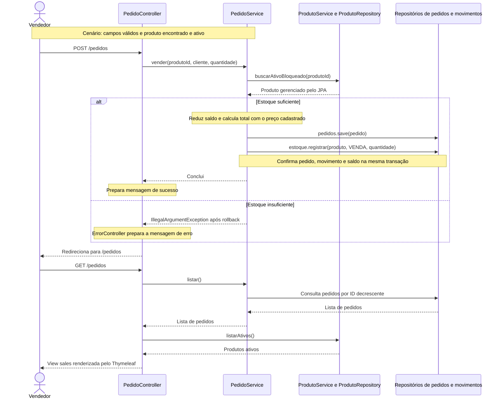
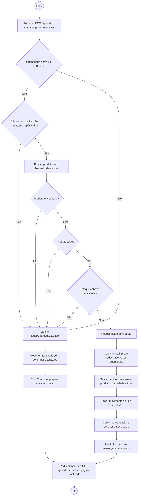
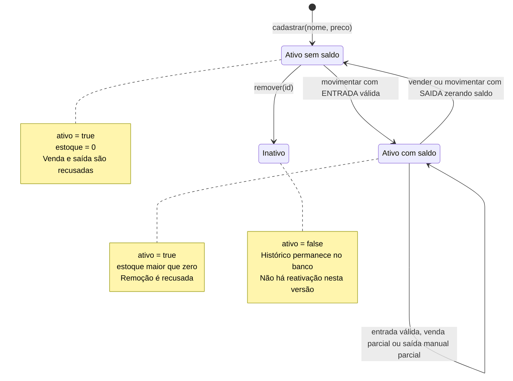

# Aula 6: comportamento do MVC

A pasta `mvc` usa a mesma organização da referência: controllers separados, entidades e serviços dentro de `model`, telas em `resources/view` e estilos em `static/css`. As regras de produtos, pedidos e movimentações foram preservadas do projeto anterior.

## Executar

Entre em `Aula6/mvc` e execute `bash mvnw spring-boot:run`. No Windows, use `.\mvnw.cmd spring-boot:run`. A página inicial abre em http://127.0.0.1:8080 e oferece acesso a Produtos, Estoque e Pedidos.

## Sequência: registrar pedido

O vendedor envia o formulário para `PedidoController`. `PedidoService` valida os campos e usa `ProdutoService` para localizar o produto com bloqueio de escrita. A venda reduz o saldo, salva o pedido e registra o movimento por `EstoqueService`, na mesma transação. Depois, o navegador é redirecionado para a lista de pedidos.

No diagrama, alguns participantes agrupam classes de persistência para facilitar a leitura. Eles não representam classes novas.

## Atividade: permitir ou recusar a venda

O fluxo começa após a conversão dos campos HTTP. Os serviços conferem quantidade, cliente, produto ativo e saldo. Uma recusa de negócio causa rollback e `ErrorController` prepara a mensagem para a tela de pedidos.

## Estados do produto

Os estados representam a combinação dos campos `ativo` e `estoque`. Um produto nasce ativo sem saldo, recebe entradas, pode ter o saldo consumido e só pode ser inativado quando o saldo está zerado. O histórico permanece no banco.

## Conferência

| Elemento | Arquivo |
|---|---|
| Requisições de pedidos | [PedidoController.java](mvc/src/main/java/br/com/mvc/controller/PedidoController.java) |
| Venda e transação | [PedidoService.java](mvc/src/main/java/br/com/mvc/model/service/PedidoService.java) |
| Produto ativo e bloqueio | [ProdutoService.java](mvc/src/main/java/br/com/mvc/model/service/ProdutoService.java) |
| Movimentações | [EstoqueService.java](mvc/src/main/java/br/com/mvc/model/service/EstoqueService.java) |
| Estado do produto | [Produto.java](mvc/src/main/java/br/com/mvc/model/entity/Produto.java) |
| Formulário de pedido | [sales.html](mvc/src/main/resources/view/sales.html) |

Cadastre um mouse por R$ 50,00, registre entrada de 10 e venda 3. O saldo deve ser 7 e o total, R$ 150,00. Tentar vender 8 deve ser recusado sem acrescentar pedido ou movimento.

`VendasEstoqueTest` e `TelasMvcTest` verificam esse comportamento. Veja [VALIDACAO.md](../VALIDACAO.md). Pagamento, envio e cancelamento não fazem parte desta versão.

Referências: aula 6 de Arquitetura de Software, do professor Pedro Henrique Nogueira Pizzutti, e organização do repositório Gapaivams/Arq.-Software fornecida para a continuação.
