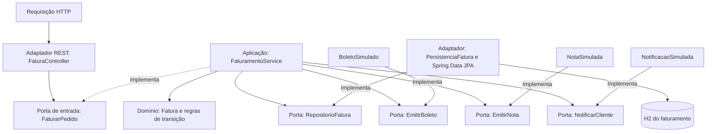

# Aula 7: faturamento em um projeto separado

A aplicação de vendas continua em MVC. O faturamento fica em `hexagonal`, com entrada HTTP, regras próprias e um banco H2 separado. A organização acompanha o exemplo da disciplina e foi adaptada aos pedidos do nosso sistema.

## Organização

| Parte | Pasta | Papel |
|---|---|---|
| Domínio | `domain/entities` | Fatura, situações e regras de transição |
| Portas | `domain/ports` | Contratos para faturar, persistir e emitir comprovantes |
| Aplicação | `application` | Coordena o faturamento por meio das portas |
| Adaptadores | `infra/adapters` | HTTP, JPA, configuração Spring e simulações |

O domínio e a aplicação usam Java sem anotações de Spring ou JPA. A infraestrutura depende desses contratos e fornece suas implementações. Assim, a regra de faturamento pode ser exercitada sem iniciar servidor ou banco.

Veja [c3-hexagonal.mmd](hexagonal/c3-hexagonal.mmd).



## Regra de faturamento

Uma fatura precisa de um pedido positivo e de um valor positivo com até duas casas decimais. O fluxo passa por `CRIADA`, `COM_BOLETO`, `COM_NOTA` e `CONCLUIDA`. A entidade recusa etapas fora dessa ordem.

O serviço consulta o pedido antes de emitir os comprovantes. Se ele já tiver uma fatura com o mesmo valor, devolve a fatura existente. Um valor diferente é recusado. O banco também mantém `pedidoId` único.

Nesta demonstração, o serviço sincroniza as solicitações em uma instância do hub. Essa escolha é simples para o laboratório e não substitui uma estratégia de concorrência entre várias instâncias.

## Simulações

`BoletoSimulado`, `NotaSimulada` e `NotificacaoSimulada` retornam identificadores como `SIM-BOLETO-1`. Não existe emissão bancária, fiscal ou envio de e-mail. As simulações são determinísticas pelo número do pedido.

As portas foram nomeadas pelo papel de negócio. Uma implementação futura pode usar mensageria, SOAP ou SMTP sem colocar essas tecnologias na classe `Fatura`.

## Executar

Com JDK 21, entre em `Aula7/hexagonal` e execute:

```bash
bash mvnw spring-boot:run
```

No Windows, use `.\mvnw.cmd spring-boot:run`. O serviço atende em `http://127.0.0.1:8081`.

Teste o contrato:

```bash
curl -X POST http://127.0.0.1:8081/faturas \
  -H 'Content-Type: application/json' \
  -d '{"pedidoId":1,"valor":150.00}'
```

A resposta HTTP 200 contém `faturaId`, `pedidoId`, `valor`, `situacao`, `boleto`, `nota` e `notificacao`. Repetir o pedido com o mesmo valor devolve o mesmo ID. Dados de negócio inválidos retornam 400. Para consultar, use `GET /faturas/{faturaId}`; um ID inexistente retorna 404.

O contrato desta implementação usa `/faturas`. O cliente da aula 8 usa o mesmo caminho.

## Verificar o núcleo sem baixar dependências

Dentro de `hexagonal`:

```bash
bash verificar.sh
```

O script compila o domínio, a aplicação e os adaptadores simulados. Verifica campos inválidos, ordem das etapas, repetição de pedido e falha antes de salvar. Ele não verifica HTTP, JPA ou H2. Os resultados estão em [VALIDACAO.md](../VALIDACAO.md).

## Limites

O hub foi preparado para um único sistema de vendas local. Se outros sistemas utilizarem o mesmo serviço, a identificação do pedido deve incluir a origem. A sincronização em memória também precisaria ser substituída para atender várias instâncias.

Em uma integração real, uma falha depois de emitir um comprovante exigiria recuperação e idempotência no provedor. Nesta etapa os comprovantes são locais e simulados. O hub só salva a fatura quando o fluxo termina.

Referência: material da aula 7 e projeto `Aula7/hexagonal` fornecido na disciplina de Arquitetura de Software, do professor Pedro Henrique Nogueira Pizzutti.
