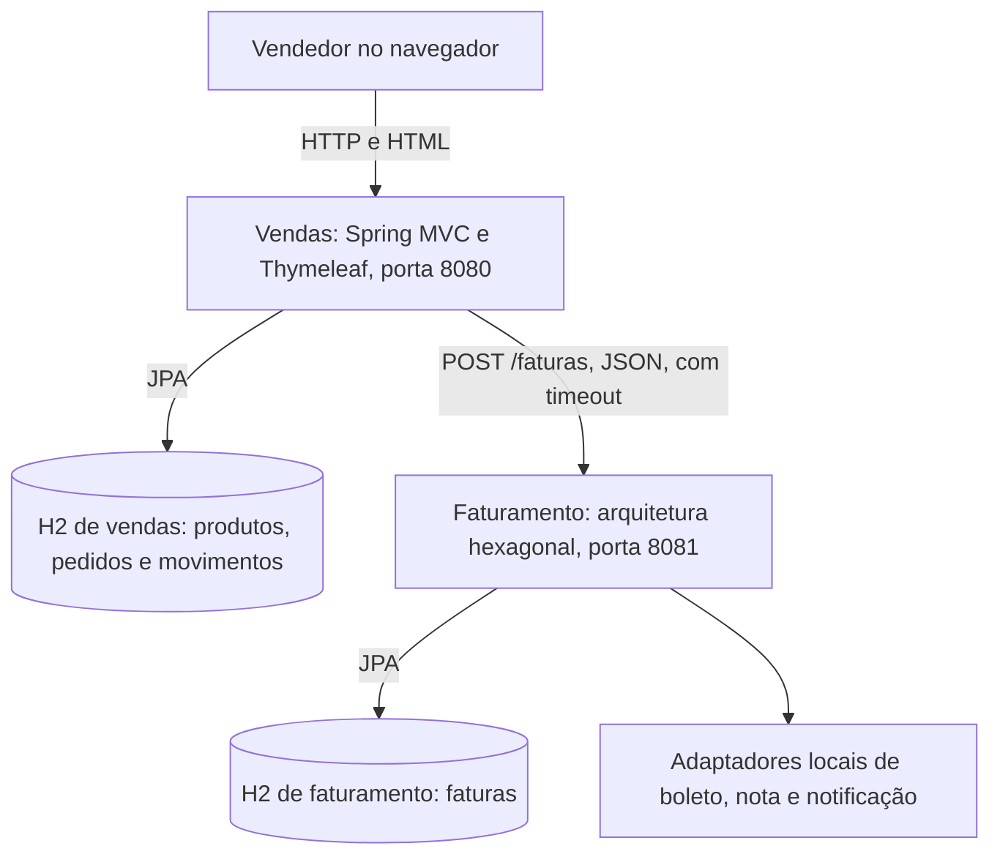
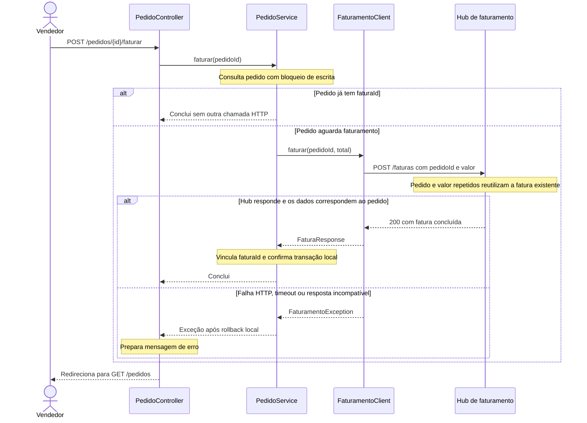
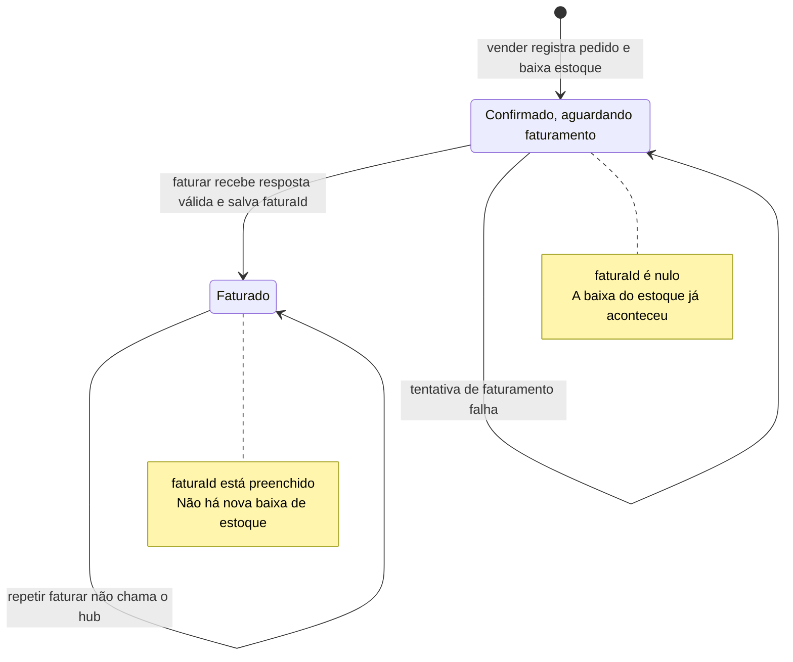

# Aula 8: ligando vendas e faturamento

Esta versão mantém o MVC da aula 5 e acrescenta um cliente HTTP para o projeto hexagonal da aula 7. O formulário confirma a venda e baixa o estoque como antes. O botão **Faturar pedido**, na lista de pedidos, solicita a fatura ao outro processo.

## Projetos e dados

| Projeto | Porta | Banco local |
|---|---|---|
| `Aula8/mvc` | 8080 | `Aula8/mvc/data/vendas` |
| `Aula7/hexagonal` | 8081 | `Aula7/hexagonal/data/faturamento` |

Cada aplicação tem configuração, processo e banco próprios. As aplicações conversam por REST; o MVC não acessa o banco do hub. Veja [c2-integracao.mmd](c2-integracao.mmd).



## Como executar

Use JDK 21 e dois terminais. No primeiro, entre em `Aula7/hexagonal`; no segundo, em `Aula8/mvc`. Em cada pasta, execute:

```bash
bash mvnw spring-boot:run
```

No Windows, use `.\mvnw.cmd spring-boot:run`. Abra `http://127.0.0.1:8080`. Execute somente uma das versões MVC por vez, pois as aulas 5, 6 e 8 usam a porta 8080.

## Roteiro de demonstração

1. Cadastre um mouse por R$ 50,00 e registre entrada de 10 unidades.
2. Confirme um pedido de 3 unidades. O total deve ser R$ 150,00 e o saldo, 7.
3. Clique em **Faturar pedido**. A lista deve mostrar o UUID recebido do hub.
4. Atualize a página. O pedido deve continuar com a mesma fatura e o saldo, 7.
5. Para verificar uma falha, registre outro pedido, encerre o hub e tente faturá-lo. O MVC deve mostrar o erro, mantendo o pedido sem fatura.
6. Inicie o hub novamente e repita o faturamento desse pedido.

## Caminho da solicitação

`PedidoController` recebe `POST /pedidos/{id}/faturar`. O serviço bloqueia a linha do pedido e verifica se já existe `faturaId`. Se existir, retorna sem chamar o hub. Caso contrário, o cliente envia `POST /faturas` com o número do pedido e o total calculado na venda.

O cliente confere ID da fatura, pedido, valor e situação retornados. Só então o serviço vincula a fatura ao pedido. Faturar não gera movimento nem altera o estoque.

Veja [diagrama-sequencia.mmd](diagrama-sequencia.mmd) e [diagrama-estado.mmd](diagrama-estado.mmd). Os estados do pedido são descritos pela presença ou ausência de `faturaId`; não foi acrescentado um campo de pagamento.





## Falhas e repetição

O cliente configura limites de conexão e leitura de 2 segundos, ajustáveis em `application.properties`. Esses limites não representam um prazo único de 2 segundos para toda a operação.

Se houver falha HTTP, erro na leitura da resposta ou dados incompatíveis, a transação local é revertida e o pedido segue aguardando faturamento. A venda e a baixa de estoque anteriores permanecem registradas.

Pode acontecer de o hub concluir e o MVC não conseguir guardar a resposta. Nesse caso, uma nova tentativa com o mesmo pedido e valor reutiliza a fatura no hub. Não existe uma transação única entre os dois bancos.

O bloqueio do pedido é mantido durante a chamada HTTP nesta versão didática. Isso simplifica a proteção contra cliques simultâneos, mas ocupa uma transação enquanto espera a rede. Em um sistema maior, seria necessário tratar esse processo com estados intermediários e recuperação.

## Testes

Em `mvc`, execute `bash mvnw test`. O teste existente de estoque foi preservado. `FaturamentoIntegracaoTest` acrescenta um servidor HTTP local de teste para verificar repetição, falha temporária do hub e resposta com valor incompatível.

Os testes Maven ainda precisam ser executados com as dependências disponíveis. Consulte [VALIDACAO.md](../VALIDACAO.md) antes de apresentar o trabalho.

## Relação com o exemplo da aula

O ZIP de referência mostra o MVC como cliente REST do faturamento hexagonal. Essa divisão foi mantida. A aula teórica também discute separar cobrança, fiscal e notificação em microsserviços. Nesta implementação essas três funções continuam como adaptadores simulados dentro do hub.

Circuit breaker, fila, outbox, saga e event sourcing não foram implementados. São assuntos para uma próxima evolução; não são necessários para demonstrar o contrato REST entre estes dois projetos.

Referência: projetos `Aula7/hexagonal` e `Aula8/mvc` e slides da disciplina de Arquitetura de Software, do professor Pedro Henrique Nogueira Pizzutti.
