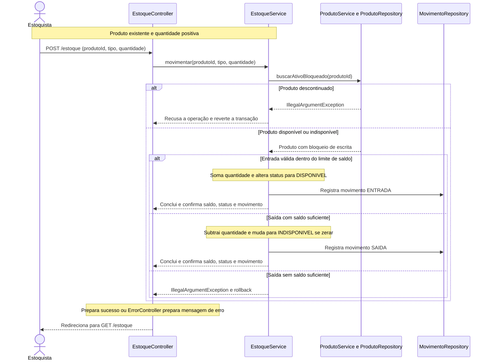
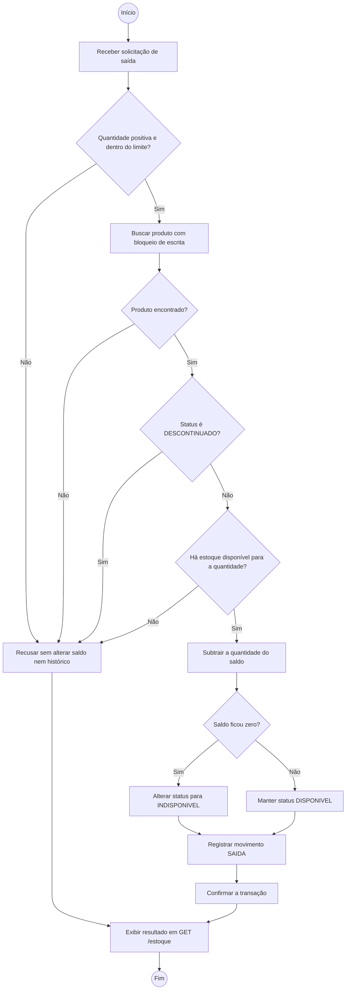
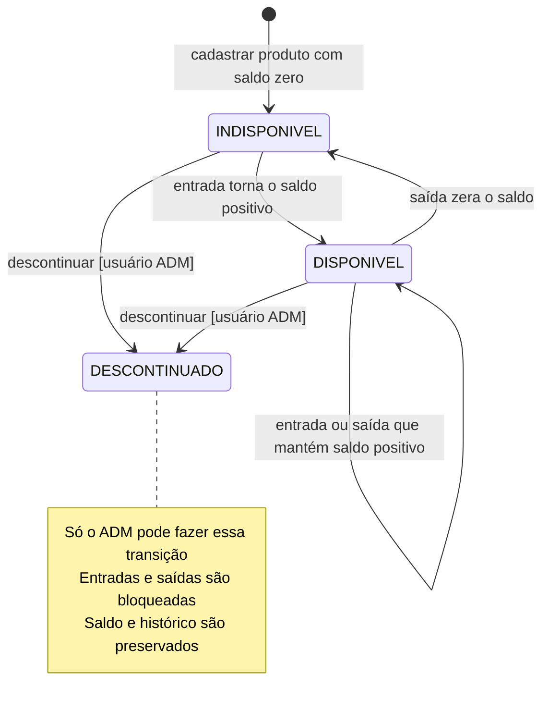

# Aula 6: módulo de estoque

Entrega em `aula-6/mvc`, com os diagramas em `.mermaid` nesta pasta. A aplicação mantém o MVC: controller recebe o formulário, serviço valida a operação e repositório persiste no H2.

## Requisitos do enunciado

| Requisito | Implementação |
|---|---|
| Produto nasce indisponível | `Produto.status` inicia como `INDISPONIVEL` e é persistido como enum |
| Saldo sai de zero | Uma entrada positiva altera o status para `DISPONIVEL` |
| Saldo zera | A saída altera o status para `INDISPONIVEL` |
| Apenas ADM descontinua | Rota protegida por papel e `ProdutoService.descontinuar` com `@PreAuthorize` |
| Descontinuado não movimenta | Serviço recusa entrada, saída e venda desse produto |
| Saída exige saldo | Quantidade positiva, bloqueio de escrita e validação de saldo antes da gravação |

A descontinuação é uma mudança de status, preservando produto, saldo e histórico. O enunciado não exige saldo zero para descontinuar; por isso, o ADM pode descontinuar um produto disponível ou indisponível. Não existe reativação nesta entrega.

## Executar e entrar

Com JDK 21, entre em `aula-6/mvc` e execute `bash mvnw spring-boot:run`. No Windows, use `.\mvnw.cmd spring-boot:run`. Abra http://127.0.0.1:8080.

| Usuário da atividade | Senha | Papel |
|---|---|---|
| `admin` | `admin123` | ADM |
| `estoquista` | `estoque123` | ESTOQUISTA |
| `vendedor` | `vendas123` | VENDEDOR |

Essas contas locais são criadas em memória. As senhas são codificadas com BCrypt durante a configuração. A autorização é verificada no servidor; enviar um campo `perfil=ADM` no formulário não concede o papel. Os formulários mantêm a proteção CSRF.

## Sequência: entrada e saída

O diagrama agrupa `ProdutoService` e `ProdutoRepository` para facilitar a leitura. O produto está gerenciado pelo JPA; saldo, status e movimento são confirmados na mesma transação.

## Atividades: saída de estoque

## Estados do produto

Os nomes do enum são `DISPONIVEL`, `INDISPONIVEL` e `DESCONTINUADO`. A tela apresenta as descrições com acentos.

## Roteiro de demonstração

1. Entre como `admin` e cadastre um mouse por R$ 50,00. Ele deve estar indisponível e com saldo zero.
2. Em Estoque, registre entrada de 10. O status deve ficar disponível.
3. Registre saída de 10. O saldo deve zerar e o status deve ficar indisponível.
4. Registre nova entrada de 3 e descontinue o produto em Produtos. O saldo deve permanecer 3.
5. Confira que o produto descontinuado não aparece para movimentar. Uma requisição manual também deve ser recusada.
6. Saia e entre como `estoquista`. A ação de descontinuar não deve ser oferecida, e a tentativa manual deve retornar 403.

## Verificação

`VendasEstoqueTest` verifica as transições de status, saldo, histórico e autorização no serviço. `TelasMvcTest` verifica os formulários e a recusa de descontinuação por um usuário sem papel ADM.

Execute `bash mvnw test` em `mvc`. Os resultados da validação ficam em [VALIDACAO.md](../VALIDACAO.md).
