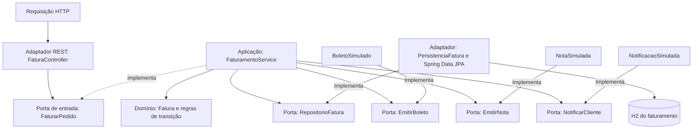

# Aula 7: faturando um pedido no hub

O projeto está em `aula-7/hexagonal`. O domínio não depende do Spring; a aplicação usa portas e os adaptadores simulam fila, SOAP e SMTP.

## Atendimento aos requisitos

| Requisito | Porta e adaptador | Resultado guardado na fatura |
|---|---|---|
| RF01: criar, persistir e devolver o ID pela REST | `FaturarPedido`, `RepositorioFatura`, `PersistenciaFatura` e `FaturaController` | UUID e dados do pedido no H2 |
| RF02: emitir boleto por fila | `EmitirBoleto` e `BoletoSimulado` | `codigoBarras` numérico |
| RF03: emitir nota fiscal por SOAP | `EmitirNota` e `NotaSimulada` | `chaveAcesso` com 44 dígitos |
| RF04: notificar por SMTP | `NotificarCliente` e `NotificacaoSimulada` | `hashEmail` do conteúdo enviado |

O adaptador de boleto publica uma solicitação numa fila em memória e o consumidor local gera o código. Na simulação, esse consumo ocorre durante a chamada. O adaptador SOAP monta um envelope XML, recebe a resposta do serviço local simulado e extrai a chave de acesso. O adaptador SMTP monta uma mensagem, simula sua aceitação e calcula o SHA-256 dos bytes UTF-8 dessa mesma mensagem.

São os adaptadores simulados pedidos no enunciado: não é necessário instalar um broker, um serviço fiscal ou um servidor SMTP. Os códigos não têm validade bancária ou fiscal. O destinatário de teste usa `cliente-{pedidoId}@exemplo.invalid`.

## Organização

| Pasta | Responsabilidade |
|---|---|
| `domain/entities` | Fatura, situação e validação dos comprovantes |
| `domain/ports/in` | Contrato de faturamento e consulta |
| `domain/ports/out` | Contratos de persistência, fila, SOAP e SMTP |
| `application` | Coordenação do faturamento |
| `infra/adapters/in/rest` | Controller e DTOs HTTP |
| `infra/adapters/out` | JPA e adaptadores simulados |
| `infra/config` | Montagem das dependências com Spring |



O serviço cria a fatura, registra os resultados das emissões, persiste e devolve a fatura à camada REST. A entidade exige a ordem boleto, nota e notificação e valida os formatos antes de concluir.

## Executar e conferir

Com JDK 21, entre em `aula-7/hexagonal` e execute `bash mvnw spring-boot:run`. No Windows, use `.\mvnw.cmd spring-boot:run`. O hub atende somente no ambiente local, na porta 8081.

```bash
curl -X POST http://127.0.0.1:8081/faturas \
  -H 'Content-Type: application/json' \
  -d '{"pedidoId":1,"valor":150.00}'
```

A resposta HTTP 200 contém `faturaId`, `pedidoId`, `valor`, `situacao`, `codigoBarras`, `chaveAcesso` e `hashEmail`. Use o UUID devolvido em `GET /faturas/{faturaId}` para consultar os dados persistidos.

Repetir o mesmo pedido com o mesmo valor reutiliza a fatura. Um valor diferente para o mesmo pedido é recusado com HTTP 400. O banco mantém o número do pedido único. A sincronização do serviço atende uma instância local; o exemplo não implementa coordenação entre várias instâncias.

## Testes

`bash verificar.sh` compila e executa as verificações do domínio, da aplicação e dos adaptadores simulados sem baixar dependências. Inclui a conferência do hash com o conteúdo efetivamente passado ao SMTP simulado.

`bash mvnw test` também executa `FaturaRestTest`, que verifica retorno REST, persistência e leitura dos comprovantes no H2, repetição de pedido e recusa de valor incompatível.

Consulte [VALIDACAO.md](../VALIDACAO.md) para os resultados.
