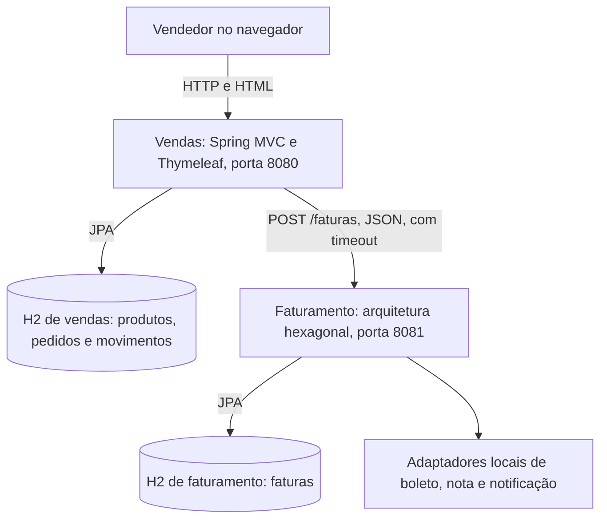
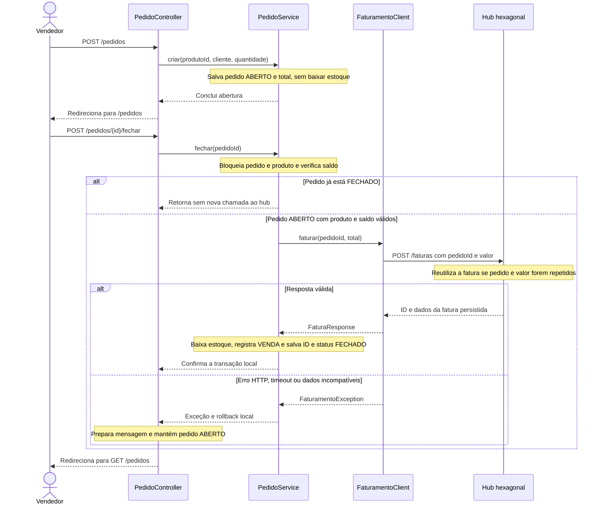
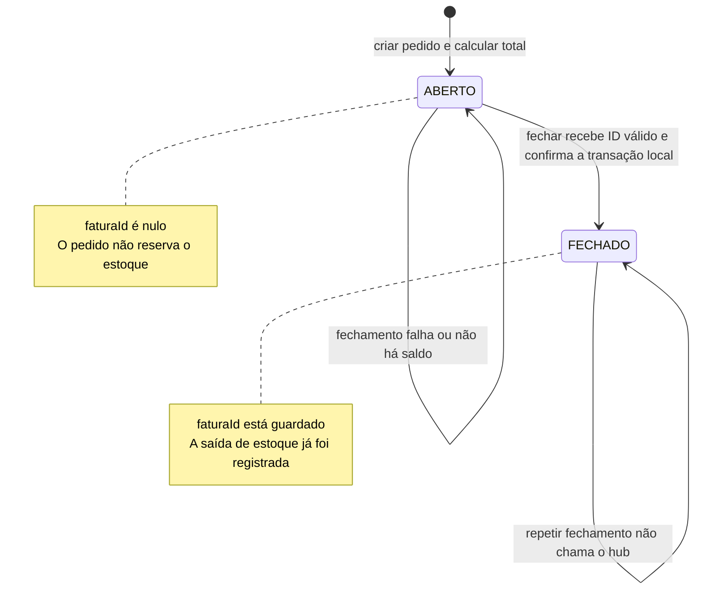

# Aula 8: integrando a venda ao hub

Entrega em `aula-8/mvc`, com a análise de dois problemas e suas soluções em [analise-integracao.md](analise-integracao.md).

A aplicação de vendas permanece em MVC. A abertura cria um pedido `ABERTO`, com o total calculado no servidor. **Fechar pedido** chama o hub REST em arquitetura hexagonal, guarda o UUID devolvido e altera o status para `FECHADO`. A saída de estoque ocorre no fechamento bem-sucedido.

## Executar

Com JDK 21, abra dois terminais: um em `aula-7/hexagonal` e outro em `aula-8/mvc`. Em cada pasta, execute `bash mvnw spring-boot:run`. No Windows, use `.\mvnw.cmd spring-boot:run`.

| Projeto | Porta | Dados |
|---|---|---|
| MVC da venda | 8080 | `aula-8/mvc/data/vendas` |
| Hub hexagonal | 8081 | `aula-7/hexagonal/data/faturamento` |

Abra http://127.0.0.1:8080. As contas locais são `admin/admin123`, `estoquista/estoque123` e `vendedor/vendas123`. Apenas ADM pode descontinuar produto. Execute uma versão MVC por vez, pois as demais aulas também usam a porta 8080.

## Demonstração

1. Entre como `admin`, cadastre um mouse por R$ 50,00 e registre entrada de 10 unidades.
2. Em Pedidos, crie um pedido de 3 unidades. Deve aparecer `ABERTO`, com total de R$ 150,00. O saldo ainda é 10.
3. Clique em **Fechar pedido**. Deve aparecer `FECHADO`, com o UUID da fatura, saldo 7 e um movimento `VENDA`.
4. Repita a solicitação de fechamento: a fatura e o saldo devem permanecer iguais.
5. Crie outro pedido, encerre o hub e tente fechá-lo. Deve continuar aberto e sem nova saída de estoque.
6. Inicie o hub novamente e repita o fechamento desse pedido.

## Comunicação e estados

O cliente valida o ID, o pedido, o valor e a situação da resposta. Durante a chamada, a transação local mantém o bloqueio do pedido e do produto para evitar fechamento e baixa duplicados. O limite de espera da rede está no cliente HTTP.

Os detalhes de timeout, repetição e divergência temporária entre os bancos estão na [análise](analise-integracao.md). O banco de vendas e o banco do hub são separados.

## Testes

Execute `bash mvnw test` em `mvc`. Os testes cobrem os formulários autenticados, os três status do produto, a exclusividade de ADM, abertura sem baixa, fechamento com UUID, repetição, falha do hub e saldo zerado pelo fechamento.

O teste REST do próprio hub fica no projeto da aula 7. O workflow do GitHub executa os quatro projetos. Veja [VALIDACAO.md](../VALIDACAO.md).
